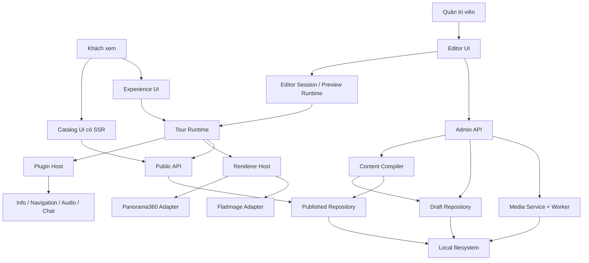

# 01. Kiến trúc tổng thể

## 1. Mục tiêu và phạm vi

Ứng dụng cho phép người quản trị giới thiệu khu du lịch, tạo nhiều tour, upload ảnh, tổ chức scene, gắn tương tác và công bố trải nghiệm. Khách xem được phép chọn tour, vào đúng scene qua liên kết, đi giữa các tour, xem panorama mặt đất, panorama trên cao hoặc ảnh flycam phẳng.

Chọn **modular monolith**: một ứng dụng Nuxt/Nitro, chia module qua hợp đồng rõ ràng. Quy mô nhỏ chưa cần microservice, database nội dung, marketplace plugin hay hệ thống cộng tác thời gian thực. Việc có `services/` trong mã nguồn không đồng nghĩa mỗi service là một tiến trình riêng.

Giả định triển khai ban đầu: một tổ chức quản lý nội dung, một hoặc vài biên tập viên, một server có volume bền vững. Không xây mô hình SaaS nhiều khách hàng trong v1. Phân quyền tối thiểu gồm khách xem và quản trị viên; có thể tách người biên tập/người công bố về sau.

## 2. Hiện trạng đã kiểm tra

| Thành phần hiện tại | Nhận xét | Hướng chuyển đổi |
| --- | --- | --- |
| `package.json`, `package-lock.json` | Lockfile có Nuxt 3.21.8, Vue 3.5.38, Tailwind 3.4.19, PSV 5.14.1 | Giữ nền tảng; nâng major là công việc riêng |
| `pages/index.vue` | Tải cố định tour `trang-bay`, hiển thị viewer ngay | Chuyển thành trang giới thiệu/catalog; viewer sang route riêng |
| `composables/useViewer360.ts` | Bọc Photo Sphere Viewer, đồng thời gọi plugin, info và audio | Tách renderer adapter khỏi Tour Runtime và Plugin Host |
| `core/plugins/` | Registry có navigation/info; API chỉ xoay quanh marker | Mở rộng cho panel, toolbar, audio, editor và xử lý server |
| `types/tour.ts`, `types/place.ts` | Hai mô hình nội dung chồng lấn | Hợp nhất về Destination → Tour → Scene |
| `server/utils/yamlLoader.ts` | TypeScript `staticTours` được ưu tiên trước YAML; ép kiểu thay vì validate | Thay bằng repository YAML + compiler có schema |
| `saveTour()` | Cập nhật RAM, bắt lỗi ghi đĩa rồi chỉ cảnh báo | Chỉ xác nhận khi lưu bền vững; lỗi trả về API |
| `tours/trang-bay.yaml` | Toàn bộ scene trong một file, đích điều hướng là ID nội bộ | Tách file và bổ sung định danh scene có tour sở hữu |
| `pages/admin/` | Có danh sách và chỉnh marker, chưa phải editor đầy đủ | Kế thừa nghiệp vụ; dùng layout và extension editor riêng |
| API admin hiện có | Chưa thấy kiểm tra đăng nhập tại các handler đã đọc | Thiết kế middleware bắt buộc ở server; cờ UI không là phân quyền |
| `docker-compose.yml` | Có MariaDB, MinIO; web chưa mount volume dữ liệu | Thay bằng web + media worker + volume khi triển khai phương án này |
| `nuxt.config.ts` | Có `serverAssets` và cấu hình MinIO/MariaDB | Tách nội dung runtime khỏi tài nguyên đóng gói lúc build |

## 3. Sơ đồ module



Chế độ preview dùng cùng hợp đồng dữ liệu runtime nhưng đi qua API có xác thực; không đi vòng qua public API để đọc draft.

## 4. Trách nhiệm và hướng phụ thuộc

| Module | Chịu trách nhiệm | Không sở hữu |
| --- | --- | --- |
| Domain/schema | Kiểu Destination, Tour, Scene, Reference, Asset; quy tắc validate | Vue component, filesystem, thư viện render |
| Content Repository | Đọc/ghi tài liệu nguồn, revision, AST và provenance | Điều khiển camera |
| Content Compiler | Parse, schema validation, phân giải include/import, kiểm tra graph, tạo runtime DTO | Thực thi plugin client hoặc gọi mô hình AI |
| Tour Runtime | Scene hiện tại, lịch sử, deep link, tải scene, hủy chuyển cảnh cũ | Parse YAML, ghi file |
| Renderer Host | Chọn adapter đúng loại scene; quản lý lifecycle | Quyết định đi scene nào |
| Panorama360 Adapter | Hiển thị ảnh cầu, camera, quy đổi tọa độ, hit test | File YAML, catalog, workflow publish |
| FlatImage Adapter | Hiển thị ảnh phẳng, zoom/pan và điểm neo theo ảnh | Suy diễn địa hình 3D từ ảnh |
| Plugin Host | Registry, capability, cấu hình, vòng đời và slot UI | Tự chọn scene bằng cách sửa store trực tiếp |
| Editor Session | Command, undo/redo, dirty state, validation, conflict, preview | Ghi trực tiếp filesystem từ browser |
| Media Service | Upload, asset metadata, bản gốc riêng tư, derivative, job | Cho public truy cập tùy ý đường dẫn đĩa |
| Publication Service | Đóng băng snapshot, kiểm tra graph và media, chuyển release | Sửa draft ngoài transaction |
| Catalog UI | Giới thiệu khu du lịch và tour; SEO | Khởi tạo WebGL khi người dùng chưa mở tour |

Domain và compiler không import Vue/PSV. Renderer chỉ nhận DTO đã resolve. Plugin khai báo nhu cầu qua context, không import editor store. API truyền ID và revision, không trả đường dẫn tuyệt đối của server.

## 5. Mô hình nội dung

- **Destination**: khu du lịch, nội dung giới thiệu, ảnh cover, danh sách tour, tour nổi bật và góc nhìn tổng quan tùy chọn.
- **Tour**: một hành trình có ID ổn định, scene bắt đầu, scene sở hữu, scene nhập từ tour khác, danh sách trình bày và theme.
- **Scene**: một điểm nhìn có renderer, nguồn ảnh, góc nhìn mặc định và các instance plugin.
- **Asset**: ảnh/audio với ID ổn định; bản gốc, lịch sử xử lý và các bản render được quản lý riêng.
- **Release**: snapshot nội dung đã validate cùng danh sách phiên bản media được phép phục vụ.

Scene khác tour có thể trùng `sceneId`, nhưng không trùng khóa `tourId#sceneId`. `sceneOrder` chỉ quyết định cách trình bày; cạnh navigation quyết định đường đi. Một scene không có cạnh vẫn có thể được mở từ danh sách.

## 6. Tổ chức thư mục mã nguồn dự kiến

Giữ cấu trúc Nuxt 3 đang có. Đây là bản đồ triển khai, không phải yêu cầu tạo tất cả file ngay.

```text
components/
  catalog/                 # Hero, DestinationCard, TourCard, Gallery
  experience/              # ViewerShell, Toolbar, InfoPanel, ScenePicker
  editor/                  # SceneTree, Inspector, AssetBrowser, PublishDialog
  ui/                      # Component dùng chung bọc Reka UI
layouts/
  default.vue              # Trang giới thiệu
  experience.vue           # Trải nghiệm toàn màn hình
  editor.vue               # Không gian quản trị
pages/
  index.vue
  destinations/[destinationId]/index.vue
  tours/[tourId]/index.vue
  experience/              # Route khởi đầu và deep link scene
  admin/                   # Destination, tour, scene, asset, publish
core/
  domain/                  # Kiểu dữ liệu và quy tắc thuần
  runtime/                 # Navigation, resolver client, scene lifecycle
  renderers/               # Hợp đồng + panorama360 + flat-image
  plugins/                 # Hợp đồng + registry + plugin tích hợp sẵn
  editor/                  # Commands, history, editor extensions
schemas/
  v1/                      # JSON Schema chuẩn + schema plugin
server/
  api/                     # Public/admin routes
  middleware/              # Auth, kiểm soát admin API
  content/                 # Parser, compiler, resolver, provenance
  repositories/            # File repository, release repository
  services/                # Catalog, tour, media, publish
workers/
  media/                   # Xử lý ảnh ở tiến trình riêng
stores/                    # Pinia store tách runtime/editor
themes/                    # Theme registry và các component cho slot
docs/
```

Nguồn dữ liệu sống trong `CONTENT_ROOT`, không nằm trong bundle `server/data/`. Chi tiết cây dữ liệu ở tài liệu 04.

## 7. Giao diện khách xem

### 7.1. Cấu trúc route

| Route | Hành vi |
| --- | --- |
| `/` | Giới thiệu thương hiệu/khu du lịch, tour nổi bật; không tự mở panorama |
| `/destinations/:destinationId` | Câu chuyện địa điểm, thư viện ảnh, danh sách tour, nút mở góc nhìn tổng quan |
| `/tours/:tourId` | Giới thiệu tour, thời lượng ước tính, số điểm nhìn, nút “Bắt đầu khám phá” |
| `/experience/:entryTourId` | Mở `entryScene` của tour được chọn |
| `/experience/:entryTourId/:ownerTourId/:sceneId` | Đi thẳng tới scene, giữ ngữ cảnh hành trình gốc |
| `/admin` và route con | Đăng nhập, quản lý nội dung, chỉ số và editor |

Ví dụ `/experience/trang-bay/doi-che/dinh-doi` phải mở `doi-che#dinh-doi` trực tiếp. Không mở `doi-che#cong-doi` trước. Khóa chứa `#` trong YAML không được nối thẳng vào URL vì sẽ thành URL fragment.

Đường dẫn chia sẻ mặc định lấy release hiện hành tại thời điểm mở. Trong phiên đang xem, runtime giữ một `releaseId` nhất quán. Link có query `release` chỉ dùng nếu sản phẩm muốn xem phiên bản đã lưu; phiên bản không còn được phục vụ trả lỗi rõ ràng.

### 7.2. Trang giới thiệu

Thứ tự khối mặc định: hero tĩnh → giới thiệu → tour nổi bật → tất cả tour → ảnh/thông tin địa điểm. Nếu có ảnh tổng quan, thêm nút “Khám phá từ trên cao” dẫn vào đúng scene. Người biên tập chọn các block được đăng ký sẵn; không cần xây trình kéo thả HTML tự do.

Thiết kế sáng cho nội dung giới thiệu, ảnh nổi bật; vùng viewer có nền tối; editor trung tính để dễ làm việc. Theme điều khiển màu, font, kích thước, bố trí slot cho khách; không được biến đổi cấu trúc công cụ quản trị tùy tiện.

### 7.3. Trang trải nghiệm

Toolbar có tên điểm nhìn, quay về trang giới thiệu, danh sách scene, âm thanh, toàn màn hình. Desktop có sidebar thu gọn; mobile dùng panel dưới. Hotspot có nhãn, trạng thái focus và đường mở tương đương trong danh sách để không phụ thuộc hoàn toàn vào thao tác trên ảnh.

Tại scene thuộc tour khác, hiển thị tên tour sở hữu và nút trở lại hành trình. Breadcrumb dùng `entryTourId` và `activeOwnerTourId` riêng; theme hành trình gốc giữ ổn định khi đi qua tour khác.

## 8. Bộ công cụ Vue/Nuxt được đề xuất

Lựa chọn ưu tiên giảm thay đổi nền tảng hiện tại. Phiên bản thực tế phải pin trong lockfile sau khi kiểm tra peer dependencies; các tài liệu chính thức dưới đây xác nhận chức năng, không thay thế việc chạy thử tích hợp.

| Thư viện | Quyết định và cách dùng |
| --- | --- |
| Tailwind CSS hiện có + Reka UI | Bộ UI chính: Dialog, Tabs, Popover, Tooltip, Select. Reka UI không áp đặt CSS, phù hợp giữ Tailwind 3 và bọc thành component dùng chung. [Giới thiệu](https://reka-ui.com/docs/overview/introduction), [tích hợp Nuxt](https://reka-ui.com/docs/overview/installation) |
| VueUse + module Nuxt tương ứng | Debounce, ResizeObserver, fullscreen, keyboard và media query; tránh viết lại nhiều composable nền tảng. [Hướng dẫn](https://vueuse.org/guide/) |
| Pinia + `@pinia/nuxt` | Store runtime/editor riêng; không đưa instance WebGL, AST lớn hoặc file ảnh vào reactive store sâu. [Tích hợp Nuxt](https://pinia.vuejs.org/ssr/nuxt.html) |
| Vue Transition và CSS | Dùng trước cho chuyển panel, toast, hover; ít dependency |
| `motion-v` — Motion for Vue | Tùy chọn khi cần chuyển động theo gesture/layout; lazy-load tại UI cần thiết. Không thêm song song nhiều hệ animation. [Tài liệu](https://motion.dev/docs/vue) |
| `@vue-flow/core` | Sơ đồ scene trong editor: node theo scene, edge theo navigation thật, hỗ trợ tương tác graph. [Vue Flow](https://vueflow.dev/guide/) |
| Icon Lucide hiện có | Tái sử dụng, kiểm tra export đúng package đang dùng trước khi mở rộng |
| Photo Sphere Viewer | Giữ làm engine panorama, bọc sau adapter. [Hướng dẫn](https://photo-sphere-viewer.js.org/guide/) |
| OpenSeadragon | Renderer ảnh flycam phẳng với zoom/pan; chuyển ảnh rất lớn sang tile pyramid. [Image Tile Source](https://openseadragon.github.io/examples/tilesource-image/) |
| `yaml` + Ajv | Parser hỗ trợ sửa cây tài liệu; JSON Schema chuẩn dùng cùng frontend/backend. [yaml](https://eemeli.org/yaml/), [Ajv](https://ajv.js.org/json-schema.html) |
| Sharp | Server/worker tạo derivative và pyramid, không đưa vào bundle client. [Output](https://sharp.pixelplumbing.com/api-output/) |

Chọn Reka UI làm mặc định thay vì yêu cầu đổi sang một bộ UI kéo theo migration Tailwind. Không cần cài đồng thời Nuxt UI, Vuetify và PrimeVue. Nếu đội triển khai chọn bộ UI khác, giữ nguyên module/domain/DSL và ghi lại tác động phiên bản trước khi đổi.

Editor YAML nâng cao có thể bắt đầu bằng textarea có đánh dấu lỗi server. Chỉ thêm code editor chuyên dụng khi đã làm tốt chỉnh sửa qua form, validation và round-trip; không để tính năng này chặn MVP.

## 9. Trạng thái, SSR và hiệu năng

- Catalog dùng SSR cho tiêu đề, mô tả và thẻ tour. API danh sách chỉ trả summary, không nhúng toàn bộ scene/marker vào HTML.
- Renderer dùng component client-only và dynamic import; editor graph cũng chỉ tải tại admin.
- Browser không tự đọc YAML. Backend biên dịch thành JSON công khai đã loại thông tin riêng tư.
- Chỉ giữ một renderer đang hoạt động; tải trước tối đa 1–2 scene gần nhất, ưu tiên preview trước ảnh đầy đủ.
- Cache metadata theo `releaseId`; media theo hash bất biến. Không cache draft như public asset.
- Với mạng chậm, cho hiển thị preview và nút retry; thao tác chuyển scene mới thay thế request cũ.
- Tôn trọng reduced motion, dừng âm thanh khi rời scene và không autoplay có tiếng.

Tiêu chí ban đầu: trang giới thiệu không tải PSV/OpenSeadragon; panel phản hồi ngay khi dữ liệu đã có; ảnh preview xuất hiện trước full resolution; không tăng số WebGL context sau nhiều lần chuyển scene. Đo chi tiết ở tài liệu 05.
